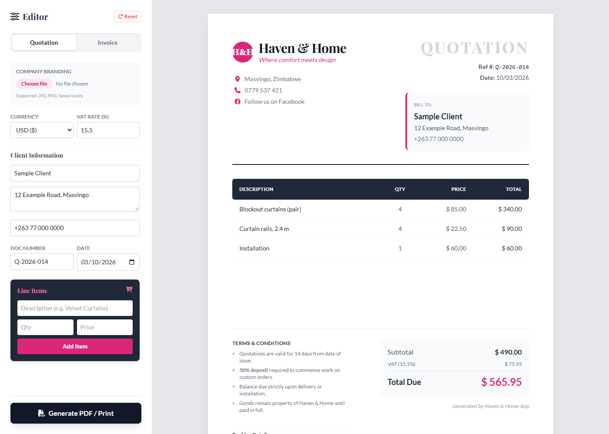

# Haven & Home: Quotation and Invoice Suite

A single-file web app built for a small interiors business in Masvingo, Zimbabwe, to produce branded quotations and
invoices in seconds. Work is **auto-saved on every keystroke**, so a power cut or a closed tab never loses a half-written
quote. There is no server, database or install: open one HTML file in a browser.



*A sample quotation. The editor is on the left, and the live A4-style document preview is on the right.*

## Designed for local conditions

Haven & Home Interiors needed professional quotes and invoices without paying for software or hosting. The design follows from that:

- **Load-shedding and unreliable internet.** Nothing should be lost when the power goes, so state lives in the browser and is saved on every change.
- **Several currencies.** Clients pay in USD, ZiG or ZAR.
- **Zimbabwe VAT** at 15.5%, adjustable.
- **No IT budget.** No hosting costs, no accounts, no installation.

## Features

- **Quotation ↔ invoice toggle:** one click switches the document title and style.
- **Line items** with description, quantity and price, plus validation (no empty descriptions, quantity > 0, numeric price) and toast messages instead of blocking alerts.
- **Live totals:** subtotal, VAT and total due.
- **Client details,** document number and date.
- **Custom logo upload:** read with `FileReader` and stored locally, with a 500 KB limit to keep within browser storage.
- **Print / Save as PDF:** a print stylesheet hides the editor and leaves only the document, including the business's terms and banking details.
- **Reset** clears the client and items (with confirmation) but keeps branding and settings.

## How it works

Everything is in [`hnhinvoice.html`](hnhinvoice.html): plain HTML, Tailwind CSS and about 280 lines of vanilla JavaScript,
organised as one `app` object:

| Layer | What it does |
|---|---|
| **State** | A single `app.data` object holds the mode, currency, VAT rate, client, document number, items and logo |
| **Persistence** | `saveState()` writes the state to `localStorage` after every change. `loadState()` merges saved data over the defaults, so older saves still load when new fields are added, and corrupted data is caught instead of crashing |
| **Controller** | `addItem`, `removeItem`, `setMode` and `handleInputChange` (two-way binding through `data-model` attributes) |
| **View** | `render()` syncs the inputs from state on reload. `renderItems()` and `renderPreview()` redraw the document |

## Run it

```bash
git clone https://github.com/TeereraiKagura/Haven-and-Home-Invoice-and-Quotation-Suite.git
```

Then open `hnhinvoice.html` in Chrome, Edge, Firefox or Safari. Click **Generate PDF / Print** and choose
"Save as PDF" to export.

Your data stays in the browser. The page loads Tailwind CSS and Font Awesome icons from CDNs, so the **first open needs
an internet connection** for styling. Data entry and saving work without one.

## What I'd improve next

- **Recalculate totals immediately when the currency or VAT rate changes.** Today the line totals refresh on the next item change or reload.
- **Escape item descriptions** before inserting them as HTML.
- **Bundle the CSS and icons** so the app is fully offline from the first open, and make it an installable PWA.
- **Auto-number documents** (Q-2026-001, INV-2026-001) and keep a history of past quotes.
- **Convert a quotation into an invoice** in one step, without retyping.
- **Make business details configurable** (they're currently set in the HTML) so other small businesses can use it.

## Tech

HTML5 · vanilla JavaScript (ES6) · Tailwind CSS (CDN) · Font Awesome · `localStorage` · `FileReader` · CSS print media queries

---

Built for Haven & Home Interiors, Masvingo, Zimbabwe.
